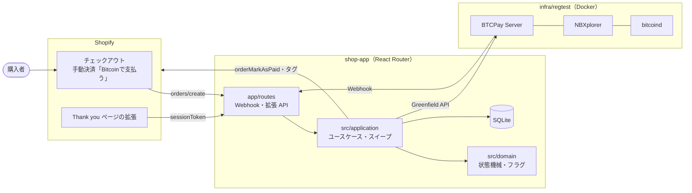

# shopify-btc-ec

[](https://github.com/atsushi196323/shopify-btc-ec/actions/workflows/ci.yml)

Shopify の開発ストアに、BTCPay Server（regtest）を使った Bitcoin 決済を自作で組み込んだポートフォリオです。
公式プラグインは使わず、**invoice の発行 → Webhook → 注文の更新**を TypeScript で実装しています。実際のお金は扱いません。

重点を置いたのは、決済で起きる「ずれ」を取りこぼさないことです。

- Webhook の重複・欠落・順序の入れ替わり、作成途中のクラッシュ、同じ注文への同時リクエスト
- 過少払い・過払い・期限後の入金・二重払い
- これらを、本物の BTCPay と bitcoind（regtest）を使う統合テストで CI から継続的に確かめています（9シナリオ）。

## 構成



- **Shopify への組み込み**: 手動決済方法で注文を支払い待ちのまま確定し、Thank you / 注文状況ページの Checkout UI Extension から BTCPay の支払い画面へ誘導します（[ADR 1](docs/adr/0001-checkout-integration.md)）。
- **ポートとアダプタ**: `src/domain` は外部依存ゼロ、`src/application` はポートだけに依存し、BTCPay・Shopify・DB は `src/adapters` に閉じ込めています（[ADR 3](docs/adr/0003-single-app-ports-and-adapters.md)）。
- 支払いの流れと状態遷移の図は [docs/diagrams/payment-flow.md](docs/diagrams/payment-flow.md) にあります。

## 設計のポイント

| 課題 | どう扱ったか | ADR |
|---|---|---|
| 金額の改ざん | 拡張から来た注文 ID は信用せず、Admin API で取り直した請求額で invoice を作る | [4](docs/adr/0004-server-side-amount-and-guest-risk.md) |
| invoice の二重作成 | DB に先に予約行を作り（`shopifyOrderId` が UNIQUE）、BTCPay の `orderId` 欄に試行の ID を入れる。作成途中で落ちても、スイープが ID で探して回復する | [5](docs/adr/0005-invoice-creation-dedup-and-orphan-recovery.md) |
| 状態と異常の混同 | 自動処理の進み具合（status）と、人が対応すべきお金の異常（フラグ）を別の軸で持つ | [6](docs/adr/0006-status-and-review-flags.md) |
| 有効な invoice が2つできる | Payment から現在の試行を指すポインタを複合外部キーで持ち、「有効な試行は最大1件」を構造で保証する | [7](docs/adr/0007-current-attempt-pointer.md) |
| Webhook の重複・欠落 | inbox に保存してすぐ 200 を返し、ペイロードは信用せず Greenfield から取り直す。Shopify への反映は `shopifySync` で追いつくまで繰り返す | [8](docs/adr/0008-inbox-and-idempotent-side-effects.md) |
| 期限後の入金・二重払い | 自動では支払い済みにせず、フラグと注文のタグで人の対応に回す | [9](docs/adr/0009-payment-confirmation-and-anomaly-policy.md) |
| テストの不安定さ | レートを固定し、ブロック生成をテストから行う。遅延・例外はアダプタを包むテスト用デコレータで注入し、本番コードに分岐を入れない | [10](docs/adr/0010-deterministic-testing.md) |

設計の全体は [docs/design.md](docs/design.md)、判断の理由は [docs/adr/](docs/adr/) にあります。

## テスト

| 層 | 対象 | 実行 |
|---|---|---|
| 単体 | ドメインの全遷移と不正な遷移、フラグ、不変条件 | `pnpm test` |
| アダプタ | BTCPay の署名検証（既知のベクタ）、Shopify の GraphQL を保存した Admin API のスキーマで検証 | `pnpm test` |
| 統合 | 本物の BTCPay と bitcoind（regtest）、フェイクの Shopify で下の9シナリオ | `pnpm test:integration` |

統合テストのシナリオ（`apps/shop-app/tests/integration/`）

1. 正常系（入金 → 1ブロック生成 → PAID）
2. 期限切れ → 再発行 → 支払い（古い invoice への期限後の入金で、新しい invoice が無効化される）
3. 過少払いのまま期限切れ → UNRESOLVED + UNDERPAID
4. 過払い → PAID + OVERPAID
5. 同じ Webhook を再送しても、Shopify の呼び出しは1回
6. Webhook を遮断しても、スイープで PAID に収束する
7. invoice 作成の競合（Webhook と拡張をそれぞれ10並列で送っても、Payment と invoice はどちらも1件）
8. クラッシュからの回復（BTCPay で作成した後、DB の更新前に例外を注入する。初回の作成と再発行の両方）
9. 二重払いを並列に処理しても、DOUBLE_PAYMENT フラグがちょうど1件付く

Shopify とのつなぎ込み（拡張の表示、`orders/create` の受信、アプリ全体の起動）は、下の手動の E2E で確かめています（CI では確かめられないので、変更したときに手で通します）。

### どのテストが何を守っているか

統合テストの各シナリオは、下の層のテストでも細かい場合分け（処理の順番・競合・失敗の注入）まで確かめています。

| シナリオ | 統合テスト | 下の層のテスト |
|---|---|---|
| 1. 正常系 | [btcpay-webhook-worker.test.ts](apps/shop-app/tests/integration/btcpay-webhook-worker.test.ts) | [payment.test.ts](apps/shop-app/tests/unit/domain/payment.test.ts)、[process-btcpay-event.test.ts](apps/shop-app/tests/application/process-btcpay-event.test.ts) |
| 2. 期限切れ → 再発行、期限後の入金で新しい invoice を無効化 | [scenario-02-03-04-09-anomalies.test.ts](apps/shop-app/tests/integration/scenario-02-03-04-09-anomalies.test.ts) | [reissue-and-invalidate.test.ts](apps/shop-app/tests/application/reissue-and-invalidate.test.ts) |
| 3. 過少払い → UNRESOLVED + UNDERPAID | 同上 | [payment.test.ts](apps/shop-app/tests/unit/domain/payment.test.ts) |
| 4. 過払い → PAID + OVERPAID | 同上 | [payment.test.ts](apps/shop-app/tests/unit/domain/payment.test.ts) |
| 5. Webhook の再送で Shopify を二重に呼ばない | [btcpay-webhook-worker.test.ts](apps/shop-app/tests/integration/btcpay-webhook-worker.test.ts) | [webhook-handler.test.ts](apps/shop-app/tests/adapter/btcpay/webhook-handler.test.ts)、[sync-to-shopify.test.ts](apps/shop-app/tests/application/sync-to-shopify.test.ts)（並行の反映でも `orderMarkAsPaid` は1回） |
| 6. Webhook を遮断してもスイープで収束 | [scenario-06-sweep-without-webhooks.test.ts](apps/shop-app/tests/integration/scenario-06-sweep-without-webhooks.test.ts) | [sweep.test.ts](apps/shop-app/tests/application/sweep.test.ts) |
| 7. invoice 作成の競合（10並列 × 2） | [scenario-07-concurrent-create.test.ts](apps/shop-app/tests/integration/scenario-07-concurrent-create.test.ts) | [create-invoice.test.ts](apps/shop-app/tests/application/create-invoice.test.ts)、[extension-invoice.test.ts](apps/shop-app/tests/application/extension-invoice.test.ts)、[prisma-payment-repository.test.ts](apps/shop-app/tests/adapter/db/prisma-payment-repository.test.ts) |
| 8. クラッシュからの回復 | [scenario-08-crash-recovery.test.ts](apps/shop-app/tests/integration/scenario-08-crash-recovery.test.ts) | [create-invoice.test.ts](apps/shop-app/tests/application/create-invoice.test.ts)（孤児の回復）、[sweep.test.ts](apps/shop-app/tests/application/sweep.test.ts) |
| 9. 二重払いで DOUBLE_PAYMENT がちょうど1件 | [scenario-02-03-04-09-anomalies.test.ts](apps/shop-app/tests/integration/scenario-02-03-04-09-anomalies.test.ts) | [invariants.test.ts](apps/shop-app/tests/unit/domain/invariants.test.ts)（処理の順番の全組み合わせ）、[process-btcpay-event.test.ts](apps/shop-app/tests/application/process-btcpay-event.test.ts)（並列の処理） |

シナリオのほかに守っていること

| 守っていること | テスト |
|---|---|
| 状態は遷移表どおりにしか進まず、古い・同じ状態の観測は何もしない（全遷移と不正な遷移） | [invoice-attempt.test.ts](apps/shop-app/tests/unit/domain/invoice-attempt.test.ts)、[payment.test.ts](apps/shop-app/tests/unit/domain/payment.test.ts) |
| 不変条件1〜5（[design.md 4章](docs/design.md)）。観測の全組み合わせ（試行1つで 25³ 通り、2つで 50³ 通り）を当て、1手ごとに確かめる | [invariants.test.ts](apps/shop-app/tests/unit/domain/invariants.test.ts)、[review-flag.test.ts](apps/shop-app/tests/unit/domain/review-flag.test.ts) |
| 有効な試行は最大1件（複合外部キーが実際に違反を拒む。ADR 7） | [current-attempt-pointer.test.ts](apps/shop-app/tests/adapter/db/current-attempt-pointer.test.ts)、[review-flag-and-inbox.test.ts](apps/shop-app/tests/adapter/db/review-flag-and-inbox.test.ts) |
| SQLite の WAL・`busy_timeout`・`foreign_keys` | [sqlite.test.ts](apps/shop-app/tests/adapter/db/sqlite.test.ts) |
| `src/domain` は外部に依存しない（ADR 3） | [no-external-deps.test.ts](apps/shop-app/tests/unit/domain/no-external-deps.test.ts) |
| BTCPay の Webhook の署名（本物の配信から作った既知のベクタ）。署名が合わない配信は inbox に入れない | [webhook.test.ts](apps/shop-app/tests/adapter/btcpay/webhook.test.ts)、[webhook-handler.test.ts](apps/shop-app/tests/adapter/btcpay/webhook-handler.test.ts) |
| Shopify の GraphQL が保存した Admin API のスキーマに合い、結果の型の null 許容が一致する（ADR 10） | [admin-gateway.test.ts](apps/shop-app/tests/adapter/shopify/admin-gateway.test.ts) |
| 請求額は Admin API から取り直し、別のショップの注文には答えない（ADR 4） | [create-invoice.test.ts](apps/shop-app/tests/application/create-invoice.test.ts)、[extension-invoice.test.ts](apps/shop-app/tests/application/extension-invoice.test.ts) |
| 統合テストが本番と同じ依存の組み立てを使う（ADR 10） | [composition.test.ts](apps/shop-app/tests/app/composition.test.ts) |
| 本物の BTCPay の振る舞い（無効化した invoice への入金の読み方など。ADR 9） | [greenfield-client.test.ts](apps/shop-app/tests/integration/btcpay/greenfield-client.test.ts) |

## ローカルで動かす

必要なもの: Docker、Node.js 22.12 以上、pnpm、Shopify CLI（手動の E2E のみ）

### テストを流す

```sh
# regtest の依存サービス（bitcoind・NBXplorer・BTCPay・Postgres）を起動し、BTCPay を初期設定する
docker compose -f infra/regtest/docker-compose.yml up -d
infra/regtest/bootstrap.sh   # down -v の直後に実行する。値は infra/regtest/.bootstrap.env に出る

cd apps/shop-app
pnpm install
pnpm prisma generate
pnpm test               # 単体・アダプタ
pnpm test:integration   # 統合（期限切れを待つシナリオがあるので数分かかる）
```

- BTCPay の管理画面は http://localhost:49392 （`admin@example.com` / `Passw0rd!regtest`。regtest 専用の値）。
- `curl -s http://localhost:49392/api/v1/health` が `{"synchronized":true}` になれば準備完了です。
- Docker の再起動後に戻らないときの手順は [infra/regtest/README.md](infra/regtest/README.md) にあります。

### 手動の E2E（Shopify の開発ストア）

1. Shopify の開発ストアに、手動決済方法「**Bitcoinで支払う**」を作る（名前はコードで持っているので変えない）。
2. regtest を上の手順で起動し、`apps/shop-app` で `pnpm dev`（`shopify app dev`）を起動する。
   アプリは port 3000 に固定していて、BTCPay の Webhook は `http://host.docker.internal:3000/webhooks/btcpay` に届く。
   `--use-localhost` は使わない（Shopify の Webhook が届かなくなる）。
3. CLI が出す拡張のプレビューのリンク（`?dev=<トンネル>/extensions` 付きのカート）から注文し、「Bitcoinで支払う」で確定する。
4. Thank you ページの「Bitcoin で支払う」から BTCPay の支払い画面を開き、表示されたアドレスに送金して1ブロック生成する。
   invoice の期限は 180 秒なので、注文から3分以内に行う。

   ```sh
   cli() { docker compose -f infra/regtest/docker-compose.yml exec -T bitcoind \
     bitcoin-cli -regtest -rpcuser=ceiwHEbqWI83 -rpcpassword=DwubwWsoo3 -rpcport=43782 "$@"; }
   cli -rpcwallet=default sendtoaddress <アドレス> <金額>
   cli -rpcwallet=default -generate 1
   ```

5. 拡張の表示が「支払い済み」になり、Shopify の管理画面で注文が支払い済みになることを確かめる。

開発プレビューの注意

- `shopify app dev` を起動し直した直後は、拡張が読み込まれないことがある。拡張のファイルを保存し直し、ログに「Updated dev preview」が出てから注文する。
- トンネルの名前が途中で引けなくなったら、`shopify app dev` を起動し直す（URL が変わるので、`?dev=` 付きのリンクも作り直す）。
- 固定レートは `BTC_JPY = 10000000`（1円 = 10 sat）。数十円以下の注文は dust の下限を下回り、invoice を作れない（既知の制限）。

## 既知の制限

- ゲスト購入では、注文と購入者を強く結びつけられない。拡張 API が返す情報を最小限にすることで、このリスクを受け入れる。
- 返金・換金・税務・法規制は扱わない。異常はフラグとタグで人の対応に回す。
- 固定レートで動かしている。本番ではレートの取得元とレートの有効期限を設計する必要がある。
- 承認数は既定で 1 conf。本番では金額に応じて承認数を変えることを検討する。
- 無効化した試行を監視する期間は regtest 用に短くしている。本番では、未承認の取引がネットワークに伝わる時間を考えて長めに取る。
- 二重払いのとき、status は処理の順番によって PAID にも UNRESOLVED にもなる（DOUBLE_PAYMENT フラグは必ず付く）。
- フラグを対応済みにしてもタグは自動で外れない。
- ワーカーは同じアプリ内の簡易版で、水平スケールは考慮していない。
- BTCPay の管理画面などで、入金のない現在の invoice をアプリの外から無効化すると、試行は INVALID（終端）になるが
  Payment は AWAITING_PAYMENT のまま進まず、再発行（EXPIRED のときだけ受け付ける）もできない。invoice の無効化はアプリだけが行う前提とする。
- 同じく、BTCPay の管理画面で invoice を手で Settled・Invalid にする操作（Mark as settled / invalid）は行わない前提とする。
  手で Settled にすると、入金がなくても PAID になり、Shopify の注文も支払い済みになる。手で Invalid にした invoice は、
  アプリが入金を観測していれば INVALID_PAYMENT で人の対応に回るが、観測する前なら入金を見落とす。
- PAID の後に入金が reorg で無効になっても、何もしない（フラグも付かない）。方針（INVALID_PAYMENT を付ける）は ADR 9 にあり、実装は今後の課題。
- 孤児回復で作り直す前に注文を確かめ直し、キャンセル済み・支払い済みなどで invoice を作れなかった試行は、CREATING のまま残る。
  スイープは回るたびにその試行を確かめ直し、拡張は「作成中」として待ち続ける。
- invoice を作った後に Shopify で注文がキャンセルされても、invoice は有効なまま残り、拡張も返し続ける。
  その invoice に入金があっても、キャンセル済み・返金済みなどの注文は支払い済みにせず、`btc-review-not-marked-paid` のタグを付ける。
- BTCPay が受け付けない少額の注文（固定レートで換算すると dust の下限を下回る額）は、invoice の作成が断られ、試行は CREATING のまま残る。
  拡張は「準備中」で待った後、「再表示してください」と出す。
- 手動決済方法の名前「Bitcoinで支払う」をコードで持っている（空白と全角・半角の違いは無視して比べる）。管理画面で名前を変えると、どの注文にも invoice が作られなくなる。

## 今後の課題

優先順に、outbox の本実装、Shopify の Webhook も inbox を通して `X-Shopify-Event-Id` で重複を除く、注文の自動キャンセル、Lightning、構造化ログとメトリクス、
管理画面の要対応一覧（フラグを対応済みにしてタグを付け直す操作を含む）、reorg の実装とテスト、ドメインのミューテーションテスト（[design.md 8章](docs/design.md#8-計画)）。

## リポジトリ構成

```
apps/shop-app/
  app/routes/                 # Webhook 受信・拡張 API（薄く保つ）
  src/domain/                 # 状態機械・フラグ・不変条件（外部依存ゼロ）
  src/application/            # invoice の作成・イベント処理・再発行・スイープ
  src/adapters/{btcpay,shopify,db}/
  src/adapters/shopify-fake/  # テスト用のフェイク
  extensions/thank-you/       # Checkout UI Extension
  graphql/                    # 保存した Admin API のスキーマ
  tests/{unit,adapter,application,app,integration}/
infra/regtest/                # compose・bootstrap.sh（固定レート・ウォレット・Webhook）
docs/design.md  docs/adr/  docs/diagrams/
```
