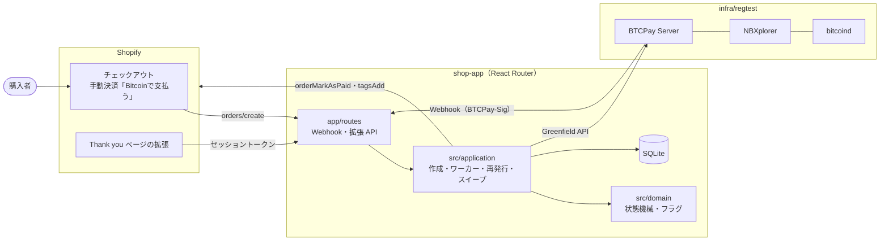
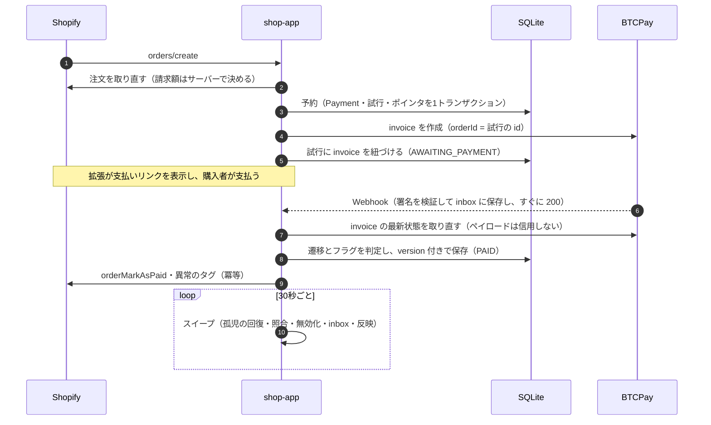
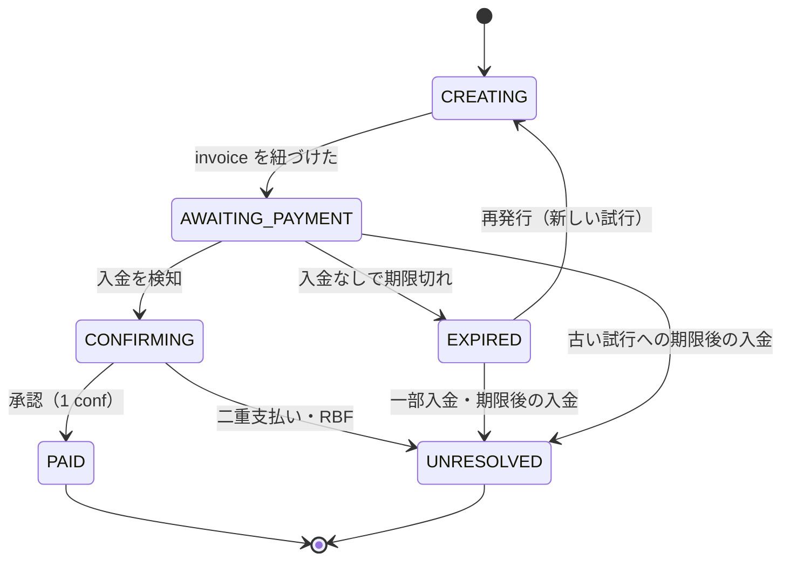

# shopify-btc-ec

Shopify の開発ストアに、BTCPay Server（regtest）を使った Bitcoin 決済を、公式プラグインを使わずに自作で組み込んだポートフォリオです。
invoice の発行 → BTCPay の Webhook → Shopify の注文の更新までを TypeScript で実装し、二重作成・Webhook の取りこぼし・途中のクラッシュ・二重払いといった
決済まわりの異常系を、設計とテストで扱っています。

- 設計: [docs/design.md](docs/design.md)
- 判断の理由: [docs/adr/](docs/adr/)（ADR 1〜10）
- 実際のお金は扱いません。BTCPay と bitcoind は Mac 上の regtest で動かします。

## 全体構成



- **組み込み方**: 手動決済方法で注文を支払い待ちのまま確定し、Thank you ページの拡張から BTCPay の支払い画面へ誘導します（[ADR 1](docs/adr/0001-checkout-integration.md)）。
- **レイヤー**: `domain`（外部依存ゼロ）← `application`（ポートだけに依存）← `adapters`（BTCPay・Shopify・Prisma）（[ADR 3](docs/adr/0003-single-app-ports-and-adapters.md)）。

## 支払いの流れ



設計の要点:

| 論点 | やり方 | ADR |
|---|---|---|
| invoice の二重作成 | `shopifyOrderId` の UNIQUE で予約し、BTCPay は commit の後に呼ぶ | [5](docs/adr/0005-invoice-creation-dedup-and-orphan-recovery.md) |
| 作成中のクラッシュ | 試行の id を BTCPay の `orderId` に入れ、スイープが検索して紐づける | [5](docs/adr/0005-invoice-creation-dedup-and-orphan-recovery.md) |
| 有効な invoice は1つ | Payment → 試行のポインタを複合外部キーで守る | [7](docs/adr/0007-current-attempt-pointer.md) |
| Webhook の重複・取りこぼし | inbox と冪等な処理。取りこぼしはスイープが Greenfield から取り直す | [8](docs/adr/0008-inbox-and-idempotent-side-effects.md) |
| 異常な入金 | 状態とは別の軸の review フラグで人の対応に回し、Shopify にタグを付ける | [6](docs/adr/0006-status-and-review-flags.md)・[9](docs/adr/0009-payment-confirmation-and-anomaly-policy.md) |

## 状態



UNRESOLVED には必ず review フラグ（UNDERPAID・LATE_PAYMENT・DOUBLE_PAYMENT・INVALID_PAYMENT）が付きます。過払いは PAID + OVERPAID です。
詳しくは [design.md 4章](docs/design.md#4-状態とフラグ)。

## 動かし方

前提: Docker Desktop、Node.js 22.12 以上、pnpm、Shopify CLI、Shopify の開発ストア。

```sh
# 1. regtest の BTCPay・bitcoind を起動して初期設定する（値は infra/regtest/.bootstrap.env に出る）
docker compose -f infra/regtest/docker-compose.yml up -d
infra/regtest/bootstrap.sh
curl -s http://localhost:49392/api/v1/health   # {"synchronized":true} になるまで待つ

# 2. アプリを起動する（port 3000 固定。--use-localhost は使わない）
cd apps/shop-app
pnpm install
pnpm dev
```

- 開発ストアの管理画面で、手動決済方法「Bitcoinで支払う」を作ります（[ADR 1](docs/adr/0001-checkout-integration.md)）。
- 手作業の手順や、Docker の再起動後に同期が止まったときの復旧は [infra/regtest/README.md](infra/regtest/README.md) にあります。
- テストの支払いとブロックの生成は `bitcoin-cli`（regtest）で行います。

## テスト

```sh
cd apps/shop-app
pnpm test               # 単体・アダプタ・application（依存なし。BTCPay と Shopify はフェイク、DB は一時的な SQLite）
pnpm test:integration   # 統合（本物の BTCPay と bitcoind の regtest が必要。port 3000 を空けておく）
```

統合テストはアプリをテストプロセスの中で組み立て、Shopify だけをフェイクにします。遅延や例外は BTCPay アダプタを包むテスト用デコレータで注入し、本番コードには分岐を入れません（[ADR 10](docs/adr/0010-deterministic-testing.md)）。

| # | シナリオ | テスト |
|---|---|---|
| 1 | 正常系（入金 → 1ブロック → PAID） | `btcpay-webhook-worker.test.ts` |
| 2 | 期限切れ → 再発行 → 支払い（古い invoice への期限後の入金で新しい invoice を無効化） | `scenario-02-03-04-09-anomalies.test.ts` |
| 3 | 過少払いのまま期限切れ → UNRESOLVED + UNDERPAID | 同上 |
| 4 | 過払い → PAID + OVERPAID | 同上 |
| 5 | 同じ Webhook を再送しても Shopify の呼び出しは1回 | `btcpay-webhook-worker.test.ts` |
| 6 | Webhook を遮断しても、スイープで PAID に収束 | `scenario-06-sweep-without-webhooks.test.ts` |
| 7 | invoice 作成の競合（10並列 × 2）で Payment も invoice も1件 | `scenario-07-concurrent-create.test.ts` |
| 8 | BTCPay で作成した後のクラッシュから回復（初回・再発行） | `scenario-08-crash-recovery.test.ts` |
| 9 | 二重払いを並列に処理しても DOUBLE_PAYMENT はちょうど1件 | `scenario-02-03-04-09-anomalies.test.ts` |

CI（GitHub Actions）は、lint・型チェック・単体テストと、regtest の BTCPay を立ち上げた統合テストを流します。

## 既知の制限

- ゲスト購入では、注文と購入者を強く結びつけられない。拡張 API が返す情報を最小限にすることで、このリスクを受け入れる。
- 返金・換金・税務・法規制は扱わない。異常はフラグとタグで人の対応に回す。
- 固定レートで動かしている。本番ではレートの取得元とレートの有効期限を設計する必要がある。
- 承認数は既定で 1 conf。本番では金額に応じて承認数を変えることを検討する。
- 無効化した試行を監視する期間は regtest 用に短くしている。本番では、未承認の取引がネットワークに伝わる時間を考えて長めに取る。
- 二重払いのとき、status は処理の順番によって PAID にも UNRESOLVED にもなる（DOUBLE_PAYMENT フラグは必ず付く）。
- MVP ではフラグを対応済みにしてもタグは自動で外れない。
- ワーカーとスイープは同じアプリ内の簡易版で、水平スケールは考慮していない。
- BTCPay の管理画面などで、入金のない現在の invoice をアプリの外から無効化すると、試行は INVALID（終端）になるが
  Payment は AWAITING_PAYMENT のまま進まず、再発行（EXPIRED のときだけ受け付ける）もできない。invoice の無効化はアプリだけが行う前提とする。
- 同じく、BTCPay の管理画面で invoice を手で Settled・Invalid にする操作（Mark as settled / invalid）は行わない前提とする。
  手で Settled にすると、入金がなくても PAID になり、Shopify の注文も支払い済みになる。手で Invalid にした invoice は、
  アプリが入金を観測していれば INVALID_PAYMENT で人の対応に回るが、観測する前なら入金を見落とす。
- PAID の後に入金が reorg で無効になっても、MVP では何もしない（フラグも付かない）。方針（INVALID_PAYMENT を付ける）は ADR 9 にあり、実装は stretch。
- 孤児回復で作り直す前に注文を確かめ直し、キャンセル済み・支払い済みなどで invoice を作れなかった試行は、CREATING のまま残る。
  スイープは回るたびにその試行を確かめ直し、拡張は「作成中」として待ち続ける（終わりの状態は設けていない。ADR 4）。
- invoice を作った後に Shopify で注文がキャンセルされても、invoice は有効なまま残り、拡張も返し続ける。注文の自動キャンセルとあわせて stretch で扱う。
  その invoice に入金があっても、キャンセル済み・返金済みなどの注文は支払い済みにしない。注文には `btc-review-not-marked-paid` のタグを付ける（ADR 8）。
- BTCPay が受け付けない少額の注文（固定レートで換算すると dust の下限を下回る額。regtest の `BTC_JPY = 10,000,000` では数十円）は、
  invoice の作成が 400 で断られ、試行は CREATING のまま残る。拡張は「準備中」で待った後、問い合わせをやめて「再表示してください」と出す。
  最小額のチェックは設けていない。
- 手動決済方法の名前「Bitcoinで支払う」をコードで持っている（空白と全角・半角の違いは無視して比べる）。管理画面で名前を変えると、どの注文にも invoice が作られなくなる。

## ADR

| # | タイトル |
|---|---|
| 1 | [Shopify チェックアウトへの組み込み方式](docs/adr/0001-checkout-integration.md) |
| 2 | [オンチェーンを優先し、Lightning は stretch](docs/adr/0002-onchain-first.md) |
| 3 | [1アプリ構成と、依存を内側に向けたレイヤー分割](docs/adr/0003-single-app-ports-and-adapters.md) |
| 4 | [請求額はサーバー側で取得する／ゲスト購入のリスクの受け入れ](docs/adr/0004-server-side-amount-and-guest-risk.md) |
| 5 | [invoice の二重作成防止と孤児の回復](docs/adr/0005-invoice-creation-dedup-and-orphan-recovery.md) |
| 6 | [状態と review フラグを分ける](docs/adr/0006-status-and-review-flags.md) |
| 7 | [有効な試行をポインタで保証する](docs/adr/0007-current-attempt-pointer.md) |
| 8 | [inbox と冪等な外部呼び出し（outbox を見送る）](docs/adr/0008-inbox-and-idempotent-side-effects.md) |
| 9 | [支払い済みとする条件と異常系のポリシー](docs/adr/0009-payment-confirmation-and-anomaly-policy.md) |
| 10 | [固定レートとテストの決定性、テストの役割分担](docs/adr/0010-deterministic-testing.md) |
