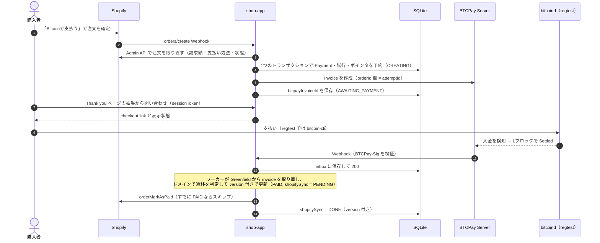
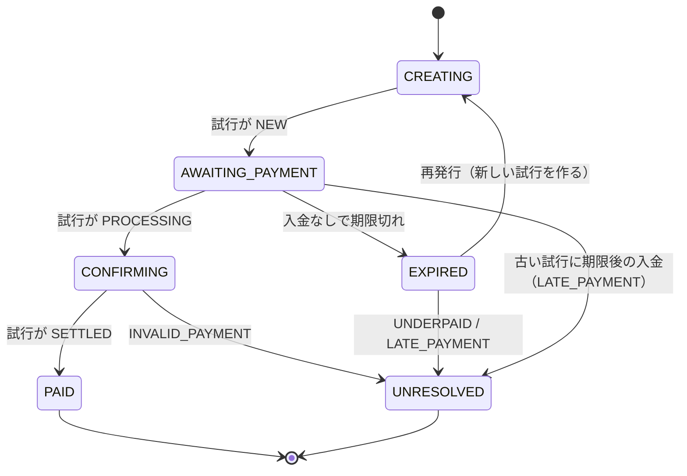
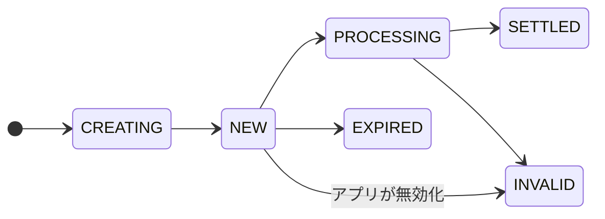

# 図: 支払いの流れと状態

README から参照する図。内容の正は [design.md](../design.md) の 4章・5章。

## invoice の作成から支払い済みまで（正常系）

Webhook が届かなくても、プロセスが途中で落ちても、30秒ごとのスイープ（design.md 5.5）が孤児の回復・照合・inbox の再処理・Shopify への反映を行い、同じ状態に収束させる。

## Payment.status

- 終端は PAID と UNRESOLVED。UNRESOLVED には必ずフラグ（ReviewFlag）が1つ以上ある。
- フラグ（UNDERPAID・LATE_PAYMENT・DOUBLE_PAYMENT・INVALID_PAYMENT・OVERPAID）は status とは別の軸で持ち、
  Shopify の注文にタグ `btc-review-<reason>` として出す（ADR 6）。

## InvoiceAttempt.status

BTCPay の invoice の状態を写したもの。前にしか進まないので、古い状態を取り直しても害にならない（無効な遷移は何もしない）。
